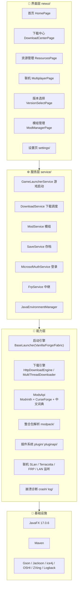
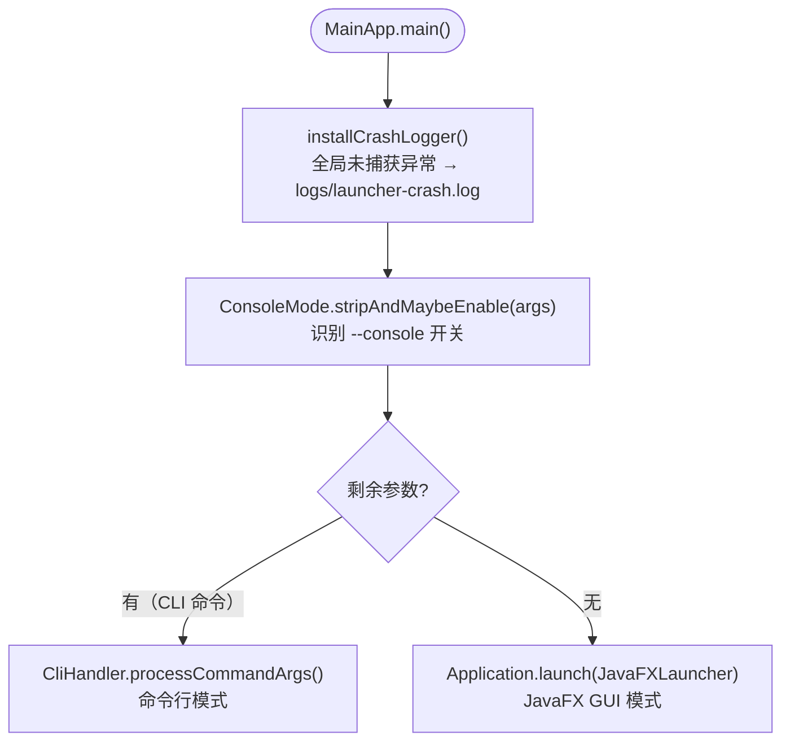
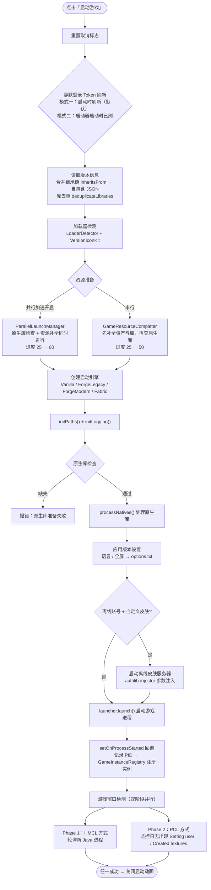
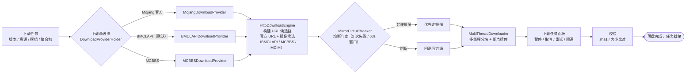
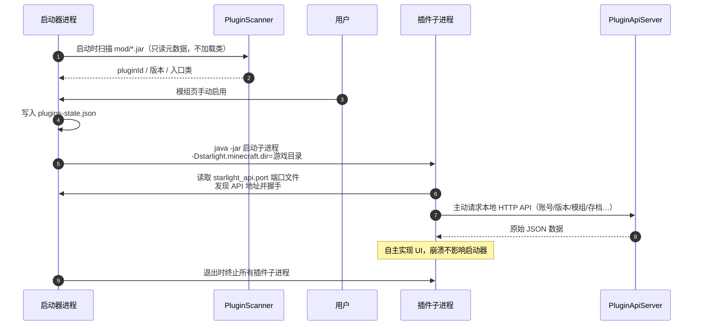

# Starlight Launcher · 星光启动器

<p align="center">
  
</p>

<p align="center">
  <b>一个用 JavaFX 从零写起的 Minecraft 启动器</b><br>
  版本管理 · 整合包安装 · 模组下载 · 联机 · 崩溃诊断 · 插件扩展
</p>

<p align="center">
  
  
  
  
</p>

<p align="center">
  <a href="https://gitee.com/Horses-always-love-to-run/starlight-launcher-cn">Gitee</a> ·
  <a href="https://github.com/Dreamo331/Starlight-Launcher">GitHub</a> ·
  <a href="docs/启动器MOD技术文档.md">MOD 开发文档</a>
</p>

---

> ⚠️ **当前状态：内测阶段（1.0.0-RELEASE）**
> 核心功能已可用，部分模块仍在打磨，接口与界面可能调整。欢迎提 Issue 反馈问题。

## 版本号规则

对外版本号统一写成 **`MAJOR.MINOR.PATCH` + 可选发布阶段后缀**，阶段顺序：

```
1.0.0-SNAPSHOT  <  1.0.0-ALPHA  <  1.0.0-BETA  <  1.0.0-RC  <  1.0.0-RELEASE
```

发版时这几处必须一致（改一处就得同步其余）：

| 位置 | 值 | 说明 |
|---|---|---|
| `newui/AppConfig.java` → `APP_VERSION` | `1.0.0-RELEASE` | **唯一权威**，界面显示、User-Agent、更新比对都用它 |
| `pom.xml` → `<version>` | `1.0.0` | 只能纯数字，Maven 与 jpackage 的 `--app-version` 不接受后缀 |
| `检查更新PHP/latest_version.json` → `version` | `1.0.0-RELEASE` | 服务端声明的最新版，写法必须与 `APP_VERSION` 完全一致 |
| GitHub / Gitee 的 tag / Release | `v1.0.0-RELEASE` | 官方接口不可用时的降级来源（带不带 `v` 都能识别） |

`lib/` 里那个核心库 jar 的 `2.0.0` 是**另一个 artifact 的版本**，与启动器版本无关，不要一起改。

版本比对规则见 `UpdateChecker.compareVersions`：先比数字段，数字相同再比阶段后缀，
后缀里的数字不算版本号（`2.0.0-rc1` 的 `1` 是第 1 个候选版）。
因此 `1.0.0-RC → 1.0.0-RELEASE` 这种「同号转正」也会被正确提示为更新。

## 目录

- [这是什么](#这是什么)
- [系统架构](#系统架构)
- [功能特性](#功能特性)
- [技术栈](#技术栈)
- [环境要求](#环境要求)
- [快速开始](#快速开始)
- [游戏启动流程](#游戏启动流程)
- [下载体系](#下载体系)
- [联机方案](#联机方案)
- [启动器 MOD 扩展](#启动器-mod-扩展)
- [项目结构](#项目结构)
- [配置与数据目录](#配置与数据目录)
- [打包原生单文件 EXE](#打包原生单文件-exe)
- [本地化](#本地化)
- [参与贡献](#参与贡献)
- [开源协议与声明](#开源协议与声明)

---

## 这是什么

Starlight Launcher（星光启动器）是一个完全用 **Java 17 + JavaFX** 编写的 Minecraft 启动器，界面与逻辑均为自研，不基于任何现成启动器壳。

它提供一套完整的「启动游戏 + 管资源 + 找模组 + 拉朋友联机 + 出事能诊断」的闭环体验，并内置一套让第三方扩展启动器自身能力的 **MOD 插件系统**。

## 系统架构



## 功能特性

### 🚀 启动与账号

- **微软正版登录**：设备码（Device Code）授权流程，无需手填密码
- **离线账号 / 外置登录**：兼容 authlib-injector（littleskin 等第三方皮肤站）
- 多账号管理、头像自动获取、最近游玩记录、静默登录
- 并行资源准备 / 并行文件校验 / 流式哈希校验，启动前校验可跳过以提速
- JVM 预热、内存参数、窗口尺寸、启动前/后自定义命令、JVM 参数自定义
- **版本独立设置**：每个版本可覆盖全局配置（内存、Java、窗口等）

### 📦 版本与下载

- 原版版本清单下载与安装（自动补全 assets / libraries / natives / 客户端 jar）
- 加载器一键安装：**Forge · NeoForge · Fabric · Quilt · OptiFine**（含 Fabric API / QSL）
- **整合包安装**：解析 CurseForge / MCBBS 清单并递归安装，自动处理继承链（`inheritsFrom`）
- 多线程分块下载、断点续传、下载任务管理面板（暂停/取消/重试/限速）
- 下载源可切换：**Mojang 官方 / BMCLAPI / MCBBS 镜像**，含镜像熔断与自动回退
- 并发下载数、CurseForge 数据源、Mod 中文搜索字典等细粒度设置

### 🔍 资源与模组

- **Modrinth + CurseForge** 双源模组搜索，内置中文词典翻译（MC 百科 / HMCL 词库）
- 模组安装、更新、启停、批量管理，自动匹配游戏版本与加载器
- 整合包 / 资源包 / 光影包 / 存档 / 截图 / 崩溃报告的集中管理
- 本地文件与远端工程匹配、模组依赖检查

### 🌐 联机

- **SLan** 局域网联机（房间创建/加入、邀请码、联机密码）
- **Terracotta** 联机（基于 ice4j 的 NAT 穿透，节点列表自动获取）
- **FRP 中继** 自建服务器联机
- Minecraft 局域网组播监听（自动发现同网段房间）

### 🎨 个性化与无障碍

- 浅色 / 深色主题跟随，自定义背景图，仿 macOS 三点式窗口按钮
- 侧边栏显隐、导航动效、滚动速度与平滑度调节、骨架屏加载
- 全套矢量图标（Lucide 风格，SVG 自绘，非 emoji）
- **辅助功能页**：高对比度、停用惯性滚动
- **色盲辅助**：可调用外置覆盖工具做实时色彩矫正，并记忆每套配置

### 🩺 崩溃诊断

- 错误码 + 崩溃原因 + 环境信息 + 关键日志的结构化展示
- 日志上传并生成**二维码**分享、日志导出为 zip、一键复制错误
- **AI 诊断**：调用大模型分析崩溃日志，结果以 Markdown 渲染在面板内

### 🧩 其他

- **网络检测**：Mojang / BMCLAPI 等目标连通性与测速
- **内存优化页**：JVM 参数优化建议与一键应用
- **帧生成**：联动 Lossless Scaling 实现游戏帧生成（系统托盘快捷切换倍率）
- **星光 MC 社区**：内置社区登录、签到、帖子与评论
- 启动器 MOD 插件系统、CLI / 控制台启动模式、检查更新

## 技术栈

| 分类 | 使用 |
|---|---|
| 语言 / 运行时 | Java 17 |
| 界面 | JavaFX 17.0.6（Controls / FXML / Web）、纯 CSS 主题 |
| 构建 | Maven（maven-assembly 打 fat-jar、GluonFX + GraalVM Native Image） |
| JSON | Gson、Jackson |
| 日志 | SLF4J + Logback |
| 系统信息 | OSHI（磁盘读写速率等） |
| 网络 | `java.net.http`、ice4j（ICE / NAT 穿透） |
| 其他 | ZXing（二维码）、commons-compress（tar.gz）、javax.mail（反馈邮件） |

## 环境要求

- **JDK 17**（编译与运行；打包原生镜像需 GraalVM 17）
- **Maven 3.8+**
- 网络可访问 Mojang / BMCLAPI / Modrinth / CurseForge（国内建议配置代理，启动器内也提供代理设置页）

## 快速开始

### 1. 克隆仓库

```bash
# Gitee（国内推荐）
git clone https://gitee.com/Horses-always-love-to-run/starlight-launcher-cn.git
cd starlight-launcher-cn

# 或 GitHub
# git clone https://github.com/Dreamo331/Starlight-Launcher.git
```

### 2. 安装本地核心库

项目依赖一个未发布到中央仓库的本地核心库 `lib/StarlightLauncher-2.0.0.jar`，先装进本地仓库：

```bash
mvn install:install-file -Dfile=lib/StarlightLauncher-2.0.0.jar \
  -DgroupId=com.starlight -DartifactId=starlight-launcher-core \
  -Dversion=2.0.0 -Dpackaging=jar
```

### 3. 填入端点与密钥配置

复制并按需填写 `src/main/resources/assets/endpoints.json`（结构说明见文件内 `_meta` / `_sources` 注释）：

```jsonc
{
  "keys": {
    "curseforgeApiKey": "你的 CurseForge API Key",
    "nvidiaNimApiKey": "你的 AI 诊断 Key（可留空，仅影响 AI 诊断功能）",
    "communityApiKey": "星光社区 Key（可留空）",
    "microsoftClientId": "Azure 应用客户端 ID（微软登录用）",
    "smtp": { "host": "", "port": "", "user": "", "password": "", "to": "" }
  },
  "services": {
    "communityApiUrl": "",
    "communitySiteUrl": "",
    "logUploadUrl": "",
    "frpControlHost": "",
    "frpControlPort": 0,
    "sponsorUrl": "",
    "colorBlindOverlayUrl": ""
  }
}
```

> 不填也能编译运行，只是对应功能不可用（会走兜底或直接报错提示）。

> ⚠️ **提交代码前务必注意**：`endpoints.json` 里是**真实密钥与个人凭据**（API Key、邮箱 SMTP 授权码等）。
> 请只提交**占位版本**，真实密钥留在本地：
> - 仓库里提交填好占位符的 `endpoints.json`，自己的真实值写进 `endpoints.local.json` 并加入 `.gitignore`；或
> - 直接只提交 `endpoints.sample.json`，本地自行复制为 `endpoints.json`（该文件名已加入 `.gitignore`）。
>
> 若密钥曾以真实值提交过，**改代码没用，必须去各平台重新签发密钥**。

### 4. 编译与运行

```bash
# 编译
mvn clean compile

# 直接运行 GUI
mvn javafx:run

# 或打成 fat-jar 后运行
mvn clean package
java -jar target/starlight-launcher-cli-1.0.0-jar-with-dependencies.jar
```

### 5. 命令行 / 控制台模式

```bash
# 以控制台模式启动（不走 GUI，可用于脚本化启动游戏）
java -jar target/starlight-launcher-cli-1.0.0-jar-with-dependencies.jar --console
```

### 入口分流



## 游戏启动流程

`GameLauncherService.launchMinecraftAsync()` 在后台线程池中执行，按阶段上报进度：



启动过程同时支持：

- 启动前/后自定义命令、JVM 参数注入
- 启动取消（`launchCancelled` 标志，各阶段检查点随时可取消）
- 帧生成器 / 色盲辅助等伴生工具与界面回调共用「游戏就绪」信号（`gameStartedSignal`）

## 下载体系

所有下载统一走「多源候选 → 分块加速 → 校验落盘」的通道：



## 联机方案

| 方案 | 原理 | 适用场景 |
|---|---|---|
| **SLan** | 局域网房间（邀请码 / 联机密码） | 同网段快速联机 |
| **Terracotta** | ice4j 的 ICE / NAT 穿透，节点列表自动获取 | 跨网络直连 |
| **FRP 中继** | 自建 FRP 服务器中继 | 需要稳定公网中继 |
| **LAN 组播监听** | Minecraft 局域网组播协议自动发现同网段房间 | 一键发现房间 |

## 启动器 MOD 扩展

启动器支持第三方 MOD 扩展自身能力，与 Minecraft 模组**完全无关**：

- MOD 放在 `~/.starlight/mod/`（便携模式下为 `Starlight-Launcher/mod/`），每个 MOD 是一个带 `launcher-plugin.json` 的 JAR
- MOD 以**独立子进程**运行（`java -jar`），与启动器不共用 ClassLoader，崩溃互不影响
- 启动器通过**本地 HTTP 服务**暴露数据接口（`PluginApiServer` + 近 30 个 `ApiProvider`），MOD 主动请求，自主实现 UI
- 新 MOD 默认禁用，需在「模组」页手动启用，状态持久化到 `plugins-state.json`



```jsonc
// launcher-plugin.json（放在 MOD JAR 根目录）
{
  "id": "community.example.my_mod",
  "name": "我的启动器MOD",
  "version": "1.0.0",
  "description": "在此描述功能",
  "launcher_api_version": "1.0.0",
  "main_class": "com.starlight.plugin.template.StarlightMod",
  "plugin_type": "community"
}
```

完整规范、API 清单与开发流程见 **[docs/启动器MOD技术文档.md](docs/启动器MOD技术文档.md)**。

## 项目结构

```
starlight-launcher/
├── pom.xml                       # Maven 构建配置
├── lib/                          # 本地依赖：StarlightLauncher 核心库
├── docs/                         # 项目文档（MOD 技术文档、下载重构、修复说明等）
├── tools/                        # 工具脚本（check_env.ps1 等）
├── temp/                         # 临时产物与依赖（jar-inspect、deps 等）
├── src/main/java/
│   ├── com/example/starlight/
│   │   ├── MainApp.java          # 入口：崩溃日志兜底 + GUI/CLI 分流
│   │   ├── JavaFXLauncher.java   # JavaFX Application 启动类
│   │   ├── newui/                # 新版 UI（当前主界面）
│   │   │   ├── page/             # 首页 / 下载中心 / 资源 / 联机 / 版本选择 …
│   │   │   ├── page/settings/    # 设置页（账号、Java、主题、无障碍、关于 …）
│   │   │   ├── ui/               # 自绘控件：图标、波纹、开关、骨架屏、主题
│   │   │   └── download/         # 下载任务卡片与任务管理
│   │   ├── version/              # 版本与加载器安装（Forge/NeoForge/Fabric/Quilt/OptiFine…）
│   │   ├── download/             # 下载引擎、各镜像 Provider、资源补全
│   │   ├── ModsApi/              # Modrinth / CurseForge / 中文词典
│   │   ├── modpack/              # 整合包清单解析
│   │   ├── plugin/ pluginapi/    # 启动器 MOD 插件系统与本地 HTTP API
│   │   ├── auth/ loginmicrosoft/ # 账号管理与微软登录
│   │   ├── slan/ frp/            # 联机（SLan / FRP）
│   │   ├── colorblind/           # 色盲辅助
│   │   ├── crash/ log/ service/  # 崩溃诊断、日志上传、后台服务
│   │   ├── config/ main/ util/   # 配置、公共工具
│   │   └── gui/                  # 旧版 UI 与启动控制类（仍在复用）
│   └── org/starlight/            # Terracotta 联机、局域网监听等移植模块
├── src/main/resources/
│   ├── fxml/                     # 界面与样式（style.css / dark-extra.css）
│   ├── i18n/                     # 多语言资源（messages*.properties）
│   ├── assets/                   # 端点配置、词典、许可清单
│   ├── images/ logo/ svg/ Skins/ # 图片与矢量资源
│   └── html/
├── native/                       # 原生组件源码（management_stub.c 等）
├── references/                   # 参考工程（启动库 jar 源码、XMCL 启动器等）
└── build-single-exe.bat          # 一键打包原生单文件 EXE
```

## 配置与数据目录

启动器所有运行时数据默认放在**用户主目录**下的 `.starlight/`（全局目录，跨启动器安装位置复用）：

| 路径 | 说明 |
|---|---|
| `~/.starlight/starlight.ini` | 主配置（`[Launcher]` 段：版本、游戏目录、Java、内存、代理等） |
| `~/.starlight/starlight-client.ini` | 个性化配置（主题、背景、下载参数、AI Key 等） |
| `~/.starlight/accounts.json` | 多账号（微软正版 / 离线 / 外置登录）与皮肤配置 |
| `~/.starlight/.account.dat` | 账号令牌（轻量混淆存储） |
| `~/.starlight/authlib-injector.jar` | 外置登录注入器（按需自动下载） |
| `~/.starlight/avatars/` | 正版头像 / 皮肤缓存 |
| `~/.starlight/mod/` | 启动器 MOD（插件）JAR |
| `~/.starlight/plugins-state.json` | 插件启用状态 |
| `~/.starlight/multiplayer.json` | 联机设置**覆盖项**（未填的键自动沿用内置默认值） |
| `~/.starlight/java/` | 自动下载的 JDK（原 `<工作目录>/tools/java`） |
| `~/.starlight/terracotta/`、`slan/`、`ColorBlindOverlay/` | 联机组件与色盲矫正工具 |
| `~/.starlight/skin/`、`wallpaper/`、`mod-dictionary/` | 皮肤、背景图、模组中文词典 |
| `~/.starlight/cache/`、`terracotta-cache/` 等 | 各类缓存与状态文件 |
| `~/.starlight/framegen/config.properties` | 帧生成器配置（原 `%APPDATA%\StarlightFrameGen`） |
| `~/.starlight/endpoints.local.json` | 真实密钥覆盖文件（可选，**免重新打包**） |
| `<工作目录>/logs/` | 启动器与游戏日志（留在程序目录，便于就地排查） |

### 历史数据自动迁移

首次以新版启动时，会自动把下列旧位置的数据并入 `~/.starlight/`（**先复制、校验后再删源**，失败不阻断启动）：

- `~/.starlight-launcher/`（已废弃的旧全局目录：账号、注入器、头像）
- `<工作目录>/Starlight-Launcher/`（旧配置与运行时组件）
- `<工作目录>/tools/java/`（旧 JDK 目录）
- `%APPDATA%\StarlightFrameGen/`（帧生成器配置）

迁移后旧目录若已清空会被删除；若仍留有本迁移不认识的文件，则**原样保留**并打印提示，不会静默丢弃。
`~/.starlight-launcher/` 里两个代码已不再引用的文件（`auth_servers.json`、`endpoints.real.json`）会被收进 `~/.starlight/legacy/`。

### 便携模式

需要绿色版 / U 盘携带时，加 `--portable` 参数启动，全部数据回落工作目录下的 `Starlight-Launcher/`（与旧版行为一致）：

```bash
java -jar target/starlight-launcher-cli-1.0.0-jar-with-dependencies.jar --portable
```

> 想「重装」启动器：全局模式下删掉 `~/.starlight/`（会连账号一起删），
> 便携模式下删掉 `Starlight-Launcher/`。游戏文件在游戏目录里，不受影响。


## 打包原生单文件 EXE

Windows 下可打包成无 JRE 依赖的原生单文件可执行程序：

- **依赖**：GraalVM 17 + MSVC（`vcvars64.bat`）+ Maven
- **一键脚本**：`build-single-exe.bat`
- **产物**：`target/gluonfx/x86_64-windows/Starlight Launcher.exe`
- **Maven 原生打包**：`mvn gluonfx:build`

> 原生镜像需要显式注册反射与资源：新增依赖或资源目录时，记得同步维护 `pom.xml` 中的
> `resourcesList` 与 `reflectionList`（例如新增 `svg/` 资源目录时需把 `svg` 加入资源白名单）。

## 本地化

- 语言资源位于 `src/main/resources/i18n/`（`messages.properties` 默认、`messages_zh_CN.properties` 中文）
- 界面文案集中在设置页「语言」中切换，欢迎补充其他语言

## 参与贡献

1. Fork 本仓库并新建分支：`git checkout -b feature/你的功能`
2. 提交前请确认 `mvn clean compile` 通过
3. 提交信息说明「改了什么 / 为什么改」
4. 发起 Pull Request

**反馈问题**时请尽量附上：

- 启动器版本（设置 → 关于）与系统版本
- 复现步骤
- 崩溃日志：`logs/launcher-crash.log` 或「崩溃诊断」页导出的 zip
- 报错截图

## 开源协议与声明

本项目以 **[MIT License](LICENSE)** 开源发布，Copyright (c) 2026 Starlight Launcher Contributors。

完整法律文档见 [`docs/`](docs/README.md)：

| 文档 | 说明 |
|---|---|
| [LICENSE-EN.md](docs/LICENSE-EN.md) | **开源协议正本（英文）**：MIT 原文 + 项目标识条款 + 第三方组件声明 |
| [LICENSE-ZH.md](docs/LICENSE-ZH.md) | 中文参考译本 |
| [用户服务协议](docs/用户服务协议.md) | EULA：软件性质、使用限制、第三方服务器免责、未成年人保护 |
| [免责声明](docs/免责声明.md) | 首启弹窗/独立页面可用的完整免责说明 |
| [隐私政策](docs/隐私政策.md) | 数据分类、日志上传边界、你的权利 |
| [安全与合规](docs/安全与合规.md) | 面向平台审核的可核查技术事实 |
| [商标与品牌使用规范](docs/商标与品牌使用规范.md) | 白/灰/黑名单：哪些用法需要书面许可 |
| [第三方声明](docs/第三方声明-Third-Party-Notices-中文.md) | 第三方组件与服务清单（中/英） |
| [存证说明](tools/legal-witness/README.md) | 法律文档的时间戳存证工具与台账（证明"这些规则在建仓之初已存在"） |

第三方组件及其许可证清单见启动器内「设置 → 版权 → 开源许可」。

> **开源不等于放弃标识权**
> 代码依 MIT 协议授权，允许修改与分发；但**未经作者明确书面许可，任何二次修改、衍生版本均不得使用本启动器的原名、原图标或原作者名义进行发布或宣传**。MIT 协议从未授予商标、名称或商誉的使用权。

> **免责声明**
> Starlight Launcher 按「AS IS」提供，与 Mojang Studios / Microsoft 无隶属关系。
> Minecraft 是 Mojang Studios 的商标，本启动器不是 Minecraft 的官方产品。
> 本启动器作为中立的基础设施，仅提供游戏启动功能，未内置任何商业服务器，亦未与任何第三方服务器达成商业合作或利益绑定；任何通过本启动器连接的第三方服务器的行为（包括但不限于充值、赞助），均属于用户与该服务器运营方的独立契约，本软件开发者不承担任何连带责任。
> 本启动器是**客户端**工具，不提供开服向导、服务端配置生成或端口映射；不得将其用于以营利为目的的「一键开服」整合包或私服客户端。
